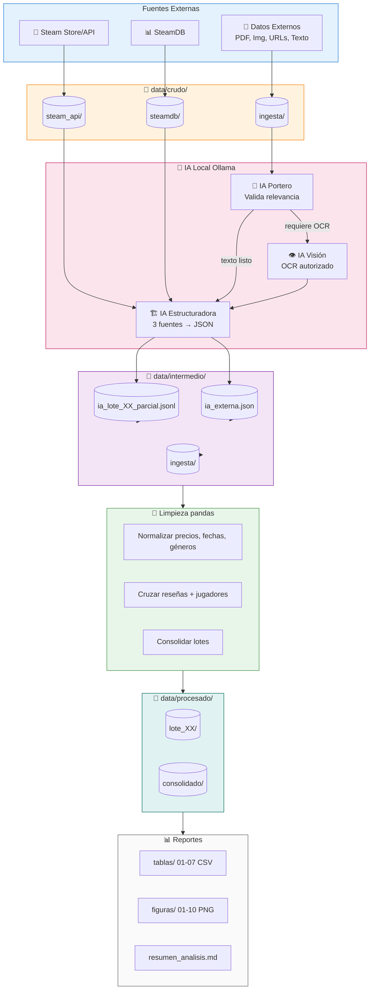
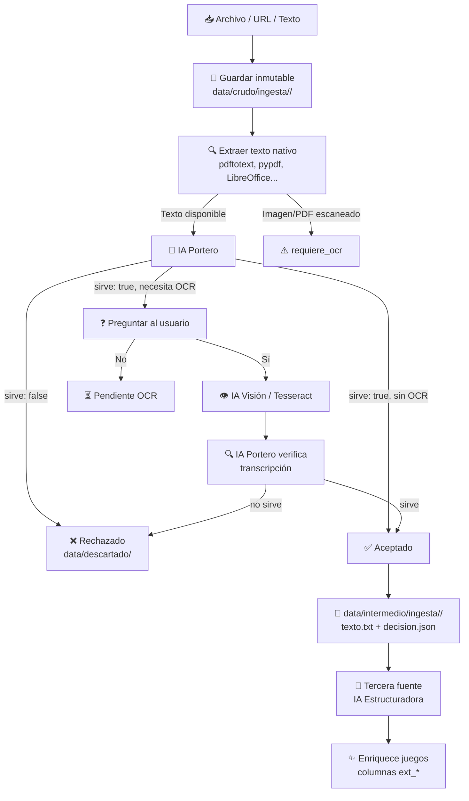

<div align="center">

# 🎮 Steam Market Analysis Pipeline

[](https://python.org)
[](LICENSE)
[](https://github.com/astral-sh/ruff)
[](tests/)
[](https://ollama.ai)
[]()

**Trabajo Práctico Final – Introducción al Análisis de Datos**

*Pipeline completo para extraer, estructurar con IA local, limpiar y analizar datos del mercado de videojuegos en Steam.*

[🚀 Quick Start](#-quick-start) • [🏗️ Arquitectura](#️-arquitectura) • [📊 Flujo de Datos](#-flujo-de-datos) • [💾 Instalación](#-instalación) • [🎯 Uso](#-uso) • [📈 Análisis](#-análisis-exploratorio) • [🤝 Contribuir](#-contribuir)

</div>

---

## ✨ Características Principales

| Característica | Descripción |
|---|---|
| 🔄 **Pipeline por lotes** | Procesa el catálogo de Steam en lotes de 100 juegos (reanudable, tolerante a fallos) |
| 🤖 **IA 100% local** | Usa Ollama para estructurar texto, clasificar juegos y hacer OCR — sin API keys ni datos en la nube |
| 🛡️ **Ingesta segura** | IA "portero" valida datos externos (PDF, imágenes, URLs, texto) y pide autorización antes de OCR |
| 🕸️ **Multi-fuente** | Combina Steam API + SteamDB (con fallback a navegador real) + datos externos |
| 📊 **Análisis listo para informe** | Genera tablas CSV, gráficos PNG y resumen Markdown respondiendo las 5 preguntas del TP |
| ⚡ **Rendimiento realista** | Respeta rate limits de Steam (~200 req/5min), reanuda tras cortes, procesa 124K+ juegos |

---

## 🏗️ Arquitectura



---

## 📦 Módulos del Proyecto

```
src/
├── config.py                 ⚙️  Configuración central + .env
├── http_util.py              🌐 Sesión HTTP con rate limiting + headers de navegador
├── extraccion/
│   ├── steam_api.py          🏪 Buscador tienda + appdetails + jugadores + reseñas
│   └── steamdb.py            📊 SteamDB con requests + fallback Playwright (Firefox)
├── ia/
│   ├── ollama_cliente.py     🤖 Cliente HTTP robusto (JSON estricto, reintentos, logs)
│   └── estructurador.py      🏗️ Convierte HTML/texto → JSON validado (solo juegos)
├── ingesta/
│   ├── archivos.py           📄 Detecta/extrae texto de 15+ formatos
│   ├── verificador.py        🚪 IA portero: decide si dato sirve + si necesita OCR
│   ├── ocr.py                👁️ Transcribe imágenes/PDFs (Ollama vision o Tesseract)
│   └── gestor.py             🎭 Orquesta: guardar → verificar → autorizar → OCR → resumir
├── limpieza/
│   └── limpiar.py            🧹 Normaliza, enriquece, consolida (pandas)
├── almacenamiento/
│   └── guardar.py            💾 I/O JSON/CSV + estado de lotes
└── analisis/
    └── exploratorio.py       📈 5 preguntas → tablas + figuras + resumen MD
```

---

## 🔄 Flujo de Datos Detallado

### Pipeline Principal (4 etapas por lote)

```mermaid
flowchart LR
    A[🏪 EXTRAER<br/>Steam API] -->|JSON + HTML crudo| B[📊 STEAMDB<br/>Playwright fallback]
    B -->|HTML crudo| C[🧠 ESTRUCTURAR<br/>IA Local Ollama]
    C -->|JSON estructurado| D[🧹 LIMPIAR<br/>pandas]
    D -->|CSV limpio| E[📦 CONSOLIDAR]
    E -->|Dataset final| F[📈 ANALIZAR]

    style A fill:#e3f2fd,stroke:#1565c0
    style B fill:#fff3e0,stroke:#ef6c00
    style C fill:#fce4ec,stroke:#c2185b
    style D fill:#e8f5e9,stroke:#2e7d32
    style E fill:#e0f2f1,stroke:#00695c
    style F fill:#f3e5f5,stroke:#7b1fa2
```



### Ingesta de Datos Externos (Tercera Fuente IA)



---

## 💾 Instalación

### Requisitos Previos

| Requisito | Versión | Notas |
|---|---|---|
| **OS** | Linux | Probado en Ubuntu 22.04+/Debian 12+ |
| **Python** | 3.11+ | Recomendado 3.11 o 3.12 |
| **RAM** | 8 GB+ | Para modelos de IA (texto + visión) |
| **Disco** | 10 GB+ | Datos crudos + modelos Ollama |
| **Red** | Conexión estable | Rate limited por Steam |

### 1. Entorno Python (con `uv` — rápido y sin sudo)

```bash
# Instalar uv
curl -LsSf https://astral.sh/uv/install.sh | sh

# Crear entorno virtual
~/.local/bin/uv venv .venv --python /usr/bin/python3

# Instalar dependencias
~/.local/bin/uv pip install --python .venv/bin/python -r requirements.txt

# Activar
source .venv/bin/activate
```

### 2. Navegador para SteamDB (opcional, recomendado)

```bash
# Playwright + Firefox para sortear Cloudflare
.venv/bin/python -m playwright install firefox
```

### 3. IA Local: Ollama

```bash
# Descargar e instalar Ollama (sin sudo)
curl -fL https://github.com/ollama/ollama/releases/latest/download/ollama-linux-amd64.tar.zst -o ollama.tar.zst
mkdir -p ~/.local/ollama && tar -I zstd -xf ollama.tar.zst -C ~/.local/ollama && rm ollama.tar.zst

# Arrancar servidor + bajar modelo por defecto
./iniciar_ollama.sh
```

> **Modelo por defecto**: `qwen2.5:7b` (configurable en `.env` como `OLLAMA_MODELO`)

### 4. OPCIONAL: OCR para imágenes/PDFs escaneados

```bash
# Opción A: IA de visión (recomendado, mejor calidad)
ollama pull qwen2.5vl:3b

# Opción B: Tesseract tradicional
sudo apt install tesseract-ocr tesseract-ocr-spa

# Herramientas PDF obligatorias para ambas opciones
sudo apt install poppler-utils  # pdftoppm, pdftotext
```

---

## 🚀 Quick Start

```bash
# 1. Clonar y entrar
git clone https://github.com/TU_USUARIO/steam-market-analysis.git
cd steam-market-analysis

# 2. Setup (ver sección Instalación arriba)
source .venv/bin/activate

# 3. Verificar que todo funciona
python pipeline.py verificar

# 4. Primer lote completo (extraer → steamdb → IA → limpiar)
python pipeline.py todo --lote 1

# 5. Ver estado
python pipeline.py estado

# 6. Más lotes...
python pipeline.py todo --lote 2
python pipeline.py todo --lote 3

# 7. Consolidar y analizar
python pipeline.py consolidar
python pipeline.py analizar

# 8. Ver resultados
ls reportes/tablas/    # 7 CSV
ls reportes/figuras/   # 10 PNG
cat reportes/resumen_analisis.md
```

---

## 🎯 Uso Detallado

### Comandos Principales

| Comando | Descripción |
|---|---|
| `python pipeline.py verificar` | 🔍 Chequea entorno: Ollama, Playwright, dependencias, OCR |
| `python pipeline.py estado` | 📋 Muestra qué etapas completadas por lote |
| `python pipeline.py todo --lote N` | 🎬 Pipeline completo para un lote (4 etapas) |
| `python pipeline.py consolidar` | 🔗 Une todos los lotes limpios en dataset final |
| `python pipeline.py analizar` | 📊 Genera tablas, figuras y resumen Markdown |

### Etapas Sueltas (Control Granular)

```bash
# Solo extracción Steam API
python pipeline.py extraer --lote 1 --cantidad 100 --orden Released_DESC

# Solo SteamDB (con URLs personalizadas)
python pipeline.py steamdb --lote 1 --uri "https://steamdb.info/charts/"

# Solo IA (probar con pocos fragmentos)
python pipeline.py estructurar --lote 1 --max-fragmentos 3

# Solo IA con datos externos ya ingeridos
python pipeline.py estructurar --fuente externa

# Solo limpieza pandas
python pipeline.py limpiar --lote 1
```

### Modo Catálogo Completo (124.373 juegos)

```bash
# Todo el catálogo (se reanuda con Ctrl+C)
python pipeline.py lotes --hasta max --sin-resenas --seguir

# Rango específico (ej: lotes 10-50)
python pipeline.py lotes --desde 10 --hasta 50 --etapas extraer,limpiar --seguir

# Solo IA + SteamDB sobre muestra para el informe
python pipeline.py lotes --desde 1 --hasta 5 --etapas steamdb,ia,limpiar --seguir
```

### Estrategia de Muestreo Recomendada

```bash
# 4 lotes × 100 juegos = muestra equilibrada por épocas/géneros
python pipeline.py extraer --lote 1 --orden Released_DESC   # Lanzamientos recientes
python pipeline.py extraer --lote 2 --orden Reviews_DESC    # Más reseñados (clásicos populares)
python pipeline.py extraer --lote 3 --orden Name_ASC        # Mezcla alfabética
python pipeline.py extraer --lote 4 --orden Released_ASC    # Juegos más antiguos

# Luego IA + limpieza en esos lotes
python pipeline.py lotes --desde 1 --hasta 4 --etapas steamdb,ia,limpiar
```

---

## 📥 Ingesta de Datos Externos

Acepta **cualquier formato**: PDF, imágenes, CSV, JSON, TXT, HTML, DOCX, XLSX, URLs, texto pegado.

```bash
# Procesar carpeta entrada/
cp informe.pdf captura.png datos.xlsx entrada/
python pipeline.py ingerir

# Archivos/URLs directos
python pipeline.py ingerir informe.pdf https://ejemplo.com/tabla.html

# Texto pegado
python pipeline.py ingerir --texto "CS2 gratis, 1.2M jugadores pico, 95% reseñas positivas"

# Corridas desatendidas (autorizar OCR sin preguntar)
python pipeline.py ingerir --autorizar-ocr

# Prohibir OCR
python pipeline.py ingerir --sin-ocr

# Re-procesar todo (forzar)
python pipeline.py ingerir --forzar
```

**Flujo de decisión:**
1. 📥 Guarda copia inmutable en `data/crudo/ingesta/<hash>/`
2. 🔍 Extrae texto nativo (si es imagen/PDF escaneado → `requiere_ocr`)
3. 🚪 **IA Portero** evalúa: `sirve`, `relevancia`, `tipo_dato`, `datos_aprovechables`
4. ❓ Si requiere OCR → **pide autorización explícita** (o `--autorizar-ocr`)
5. 👁️ OCR con IA visión (Ollama) o Tesseract
6. ✅ Aceptado → `data/intermedio/ingesta/<id>/` + tercera fuente IA estructuradora

---

## 📈 Análisis Exploratorio

El comando `analizar` responde las **5 preguntas del TP**:

| # | Pregunta | Salidas |
|---|---|---|
| 1 | **Evolución de lanzamientos** | `01_evolucion_por_anio.png`, `01_lanzamientos_por_anio.csv` |
| 2 | **Géneros: presencia y popularidad** | `02_generos.png`, `02_generos.csv` |
| 3 | **Características vs interacción** | `03_correlaciones.png`, `03_correlaciones.csv`, `05_precio_vs_resenas.png` |
| 4 | **Precios y descuentos vs actividad** | `06_rangos_precio.png`, `07_descuentos.png`, `04_rangos_precio.csv`, `05_descuentos.csv` |
| 5 | **Patrones de comportamiento usuarios** | `08_top_jugadores.png`, `09_valoracion_por_volumen.png`, `10_antiguedad_vs_jugadores.png`, `06_top_jugadores.csv`, `07_valoracion_por_volumen.csv` |

**Salida final**: `reportes/resumen_analisis.md` con hallazgos clave, números y referencias a figuras.

---

## ⚙️ Configuración (`.env`)

Copiar `.env.example` a `.env` y ajustar:

```bash
cp .env.example .env
```

| Variable | Default | Descripción |
|---|---|---|
| `OLLAMA_HOST` | `http://localhost:11434` | Servidor Ollama |
| `OLLAMA_MODELO` | `qwen2.5:7b` | Modelo de texto para estructurar |
| `OLLAMA_MODELO_VISION` | `qwen2.5vl:3b` | Modelo visión para OCR |
| `LOTE_TAMANO` | `100` | Juegos por lote |
| `PAIS` | `ar` | Código país Steam (afecta moneda/precios) |
| `STEAMDB_USAR_NAVEGADOR` | `true` | Usar Playwright si requests falla |
| `INGESTA_MOTOR_OCR` | `auto` | `auto`, `ollama`, `tesseract` |
| `INGESTA_OCR_MAX_PAGINAS` | `10` | Límite páginas PDF a escanear |
| `DIRECTORIO_ENTRADA` | `entrada/` | Carpeta para `ingerir` sin argumentos |

Ver `.env.example` para lista completa con descripciones.

---

## 📁 Estructura de Carpetas

```
.
├── entrada/                    📥 Drop zone para `ingerir`
├── data/
│   ├── crudo/                  📦 Evidencia inmutable (nunca se modifica)
│   │   ├── steam_api/          JSON/HTML de Steam (buscador, appdetails, reseñas)
│   │   ├── steamdb/            HTML/texto SteamDB + meta de bloqueos Cloudflare
│   │   └── ingesta/            Originales de datos externos (por hash SHA256)
│   ├── intermedio/             🧠 Salida de IA + bitácoras reanudables
│   │   ├── ia_lote_XX_parcial.jsonl
│   │   ├── ia_externa.json
│   │   └── ingesta/<id>/       texto.txt, decision.json, documento.json
│   ├── procesado/              ✨ Datos limpios listos para análisis
│   │   ├── lote_XX/
│   │   │   ├── juegos_lote_XX.csv
│   │   │   └── juegos_lote_XX.json
│   │   └── consolidado/
│   │       ├── juegos_consolidado.csv
│   │       ├── generos_explotado.csv
│   │       ├── datos_externos.csv
│   │       └── juegos_externos.csv
│   └── descartado/             🗑️ Lo que no es juego o no sirve (con motivo)
├── reportes/
│   ├── tablas/                 01-07 CSV (una por pregunta + extras)
│   ├── figuras/                01-10 PNG (gráficos matplotlib)
│   └── resumen_analisis.md     📝 Informe final en Markdown
├── src/                        📦 Código fuente (ver arquitectura)
├── tests/                      ✅ Unit tests (mock Ollama)
├── herramientas/               🔧 Scripts auxiliares
├── pipeline.py                 🎭 Orquestador CLI principal
├── requirements.txt
├── .env.example
└── README.md
```

---

## 🧪 Tests

```bash
# Tests rápidos (mock Ollama, sin servidor real)
python -m unittest discover -s tests -v

# Tests con coverage
.venv/bin/uv pip install pytest-cov
python -m pytest tests/ --cov=src --cov-report=term-missing
```

---

## 📊 Rendimiento y Límites

| Modo | Seg/juego | Catálogo completo | Noche (8h) |
|---|---:|---:|---:|
| Ficha + reseñas + jugadores | ~3.4 s | ~4.9 días | ~8.400 |
| Ficha + jugadores (`--sin-resenas`) | ~2.2 s | ~3.2 días | ~13.000 |
| Solo ficha (`--sin-resenas --sin-jugadores`) | ~1.7 s | ~2.5 días | ~16.900 |

> **Nota**: Limitado por rate limits de Steam (~200 req / 5 min). Bajar pausas **no** acelera, solo genera bloqueos 429.

- **IA en CPU**: Un fragmento = varios minutos. Guarda progreso en `ia_lote_XX_parcial.jsonl` (reanudable).
- **Tamaño datos**: CSV consolidado de 124K juegos ≈ decenas de MB (no es problema).

---

## ⚠️ Limitaciones Conocidas (para el informe)

- 🎯 **Muestreo**: Buscador ordenado por criterio único → no representa histórico completo
- 🛡️ **SteamDB + Cloudflare**: Bloqueos frecuentes; se guarda evidencia + meta de error
- 📸 **Snapshot temporal**: Jugadores conectados / ranking = foto del momento de extracción
- 💰 **Monedas**: `PAIS=ar` → USD desde 2023; pipeline detecta y rotula moneda real
- 🤖 **IA local pequeña**: Puede cometer errores; cada decisión guarda `motivo` + `relevancia` para auditoría
- 👁️ **OCR**: Calidad depende de imagen/modelo; revisar `texto_ocr.txt` antes de citar
- 🔐 **OCR nunca automático**: Requiere `--autorizar-ocr` o "sí" interactivo
- 🔗 **Datos externos**: No se inyectan filas en dataset principal; enriquecen por `appid`/nombre o van a tablas aparte

---

## 🤝 Contribuir

1. Fork del repo
2. Crear rama: `git checkout -b feature/nueva-funcionalidad`
3. Commits convencionales: `feat:`, `fix:`, `docs:`, `refactor:`, `test:`
4. Tests pasan: `python -m unittest discover -s tests -v`
5. Lint: `ruff check src/` (si configurado)
6. PR con descripción clara

---

## 📄 Licencia

**MIT License** — ver [LICENSE](LICENSE) para detalles.

---

## 👥 Autores

| Nombre | Rol |
|---|---|
| **Máximo Luzkevich Marino** | Desarrollo |
| **Giovanni Morro Bai** | Desarrollo |
| **Gonzalo Leonel Lopez** | Desarrollo |
| **Eloy Roldan Quevedo** | Desarrollo |

---

## 🙏 Agradecimientos

- [Ollama](https://ollama.ai) — IA local sencilla y potente
- [SteamDB](https://steamdb.info) — Datos históricos de Steam
- [Playwright](https://playwright.dev) — Automatización de navegador robusta
- [uv](https://github.com/astral-sh/uv) — Gestión de paquetes Python ultrarrápida

---

<div align="center">

**¿Te sirvió? Dale una ⭐ al repo**

[Reportar Bug](https://github.com/TU_USUARIO/steam-market-analysis/issues) • [Pedir Feature](https://github.com/TU_USUARIO/steam-market-analysis/issues/new)

</div>