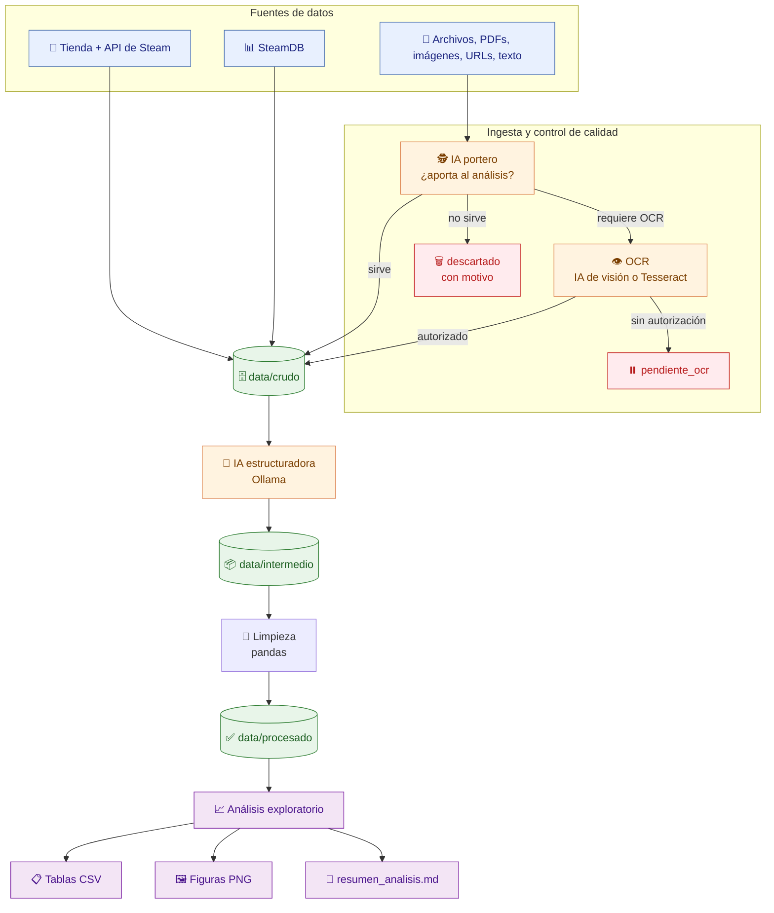
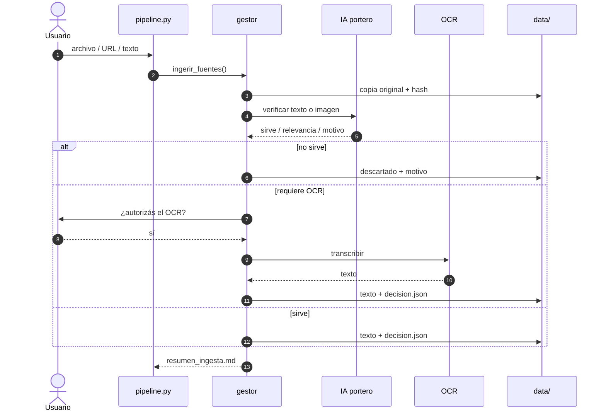

<div align="center">

<h1>🎮 Steam Market Analysis</h1>

<p><strong>Pipeline de extracción, IA local y análisis exploratorio del mercado de videojuegos de Steam.</strong></p>

<p>Trabajo Práctico Final — Parte 1 · Introducción al Análisis de Datos</p>

<p>
  <a href="https://www.python.org/"></a>
  <a href="https://pandas.pydata.org/"></a>
  <a href="https://ollama.com/"></a>
  <a href="https://playwright.dev/"></a>
  <a href="#pruebas"></a>
  <a href="LICENSE"></a>
</p>

<p>
  <a href="#descripcion">Descripción</a> ·
  <a href="#arquitectura">Arquitectura</a> ·
  <a href="#instalacion">Instalación</a> ·
  <a href="#guia-de-comandos">Comandos</a> ·
  <a href="#datos-externos-y-ocr">Datos externos</a> ·
  <a href="#resultados-y-salidas">Resultados</a>
</p>

</div>

<details>
<summary><b>📚 Tabla de contenidos</b></summary>

- [Descripción](#descripcion)
- [Características principales](#caracteristicas)
- [Arquitectura](#arquitectura)
- [Flujo del pipeline](#flujo)
- [Decisiones de diseño](#diseno)
- [Requisitos](#requisitos)
- [Instalación](#instalacion)
- [Inicio rápido](#inicio-rapido)
- [Guía de comandos](#guia-de-comandos)
- [Datos externos y OCR](#datos-externos-y-ocr)
- [Fuentes de datos](#fuentes)
- [Diccionario de datos y ficha de evaluación](#diccionario)
- [Resultados y salidas](#resultados-y-salidas)
- [Estructura del proyecto](#estructura)
- [Configuración](#configuracion)
- [Pruebas](#pruebas)
- [Herramientas auxiliares](#herramientas)
- [Rendimiento y catálogo completo](#rendimiento)
- [Limitaciones](#limitaciones)
- [Preguntas frecuentes](#faq)
- [Equipo](#equipo)
- [Contribuir](#contribuir)
- [Licencia](#licencia)
- [Agradecimientos](#agradecimientos)

</details>

---

<a id="descripcion"></a>
## 📌 Descripción

Este proyecto es un **pipeline reproducible de extremo a extremo** para analizar el mercado de
videojuegos de Steam. Extrae información del catálogo, la complementa con SteamDB y con datos
externos, usa una **IA local (Ollama)** para estructurar y clasificar el contenido, limpia todo
con **pandas** y genera tablas, gráficos y un resumen listo para el informe.

El objetivo es responder preguntas como: cómo evolucionó la cantidad de lanzamientos, qué
géneros dominan, qué relación hay entre precio, descuentos, reseñas y jugadores, y qué patrones
de comportamiento se observan en la plataforma.

> **TL;DR** — Extraé juegos de Steam, estructurá el texto con IA local, limpiá con pandas y
> obtené tablas + figuras + un resumen en Markdown. **Sin API key** y **sin servicios de IA en
> la nube**.

<table>
  <tr>
    <td align="center" width="25%">🛒<br><b>3 fuentes</b><br><sub>Steam · SteamDB · externos</sub></td>
    <td align="center" width="25%">🧠<br><b>IA 100 % local</b><br><sub>Ollama, sin nube</sub></td>
    <td align="center" width="25%">🧩<br><b>11 comandos</b><br><sub>CLI reproducible</sub></td>
    <td align="center" width="25%">🧪<br><b>12 tests</b><br><sub>sin Ollama</sub></td>
  </tr>
</table>

El pipeline trabaja con **tres fuentes**:

1. La **API pública y la tienda de Steam**.
2. **SteamDB** (tabla de más jugados y páginas de apps).
3. **Datos externos aceptados**: PDFs, imágenes, CSV, JSON, TXT, HTML, DOCX, XLSX, URLs o
   texto pegado.

Además, incluye una etapa de ingesta con **IA "portero"** que decide si un dato aporta al
análisis y un **OCR autorizado** para imágenes y PDFs escaneados.

---

<a id="caracteristicas"></a>
## ✨ Características principales

- 🔌 **Sin API key.** Usa las interfaces públicas de Steam y el HTML de la tienda.
- 🧠 **IA 100 % local.** Ollama procesa el texto en tu máquina, sin mandar datos a la nube.
- 🔎 **Tres fuentes combinadas.** Steam + SteamDB + datos externos enriquecen el mismo dataset.
- 📥 **Ingesta universal.** Acepta archivos, carpetas, URLs y texto pegado en muchos formatos.
- 🔐 **OCR con consentimiento.** Nunca se transcribe una imagen sin autorización explícita.
- ♻️ **Reanudable.** `lotes` saltea lo ya hecho, la IA retoma por fragmento y la ingesta reintenta pendientes.
- 📦 **Escalable.** Puede recorrer el catálogo completo de Steam por lotes no superpuestos.
- 📊 **Informe automático.** Genera tablas CSV, figuras PNG y `reportes/resumen_analisis.md`.
- 🧪 **Tests sin Ollama.** La IA se simula en las pruebas, así que corren en segundos.
- 🧾 **Auditable.** Cada decisión de la IA, cada bloqueo y cada descarte queda registrado.

---

<a id="arquitectura"></a>
## 🏗️ Arquitectura

El código está separado por responsabilidades. Cada módulo puede ejecutarse y probarse de forma
independiente.

| Capa | Módulo | Responsabilidad |
|:--|:--|:--|
| ⚙️ Configuración | `src/config.py` | Rutas, parámetros y lectura del archivo `.env`. |
| 🌐 HTTP | `src/http_util.py` | Sesión con cabeceras de navegador, reintentos, pausas y detección de Cloudflare. |
| 🛒 Extracción Steam | `src/extraccion/steam_api.py` | Buscador de la tienda, ficha de cada app, jugadores conectados y reseñas. |
| 📊 Extracción SteamDB | `src/extraccion/steamdb.py` | Descarga con `requests` y, si Cloudflare bloquea, con Firefox + Playwright. |
| 🧠 Cliente IA | `src/ia/ollama_cliente.py` | Cliente HTTP contra Ollama: JSON estricto, reintentos y bitácora. |
| 🧩 Estructurador IA | `src/ia/estructurador.py` | Convierte texto de SteamDB, la tienda y datos externos en filas JSON; solo deja juegos. |
| 📥 Ingesta: archivos | `src/ingesta/archivos.py` | Detecta formatos, guarda copias inmutables y extrae texto cuando es posible. |
| 🕵️ Ingesta: portero IA | `src/ingesta/verificador.py` | Decide si un dato aporta (`sirve`, relevancia, datos aprovechables, OCR necesario). |
| 👁️ Ingesta: OCR | `src/ingesta/ocr.py` | Transcribe imágenes y PDFs escaneados con IA de visión o Tesseract. |
| 🎛️ Ingesta: orquestador | `src/ingesta/gestor.py` | Encadena guardado, verificación, autorización, OCR y resumen. |
| 🧹 Limpieza | `src/limpieza/limpiar.py` | Normaliza precios, fechas, géneros y plataformas; cruza reseñas y jugadores; consolida lotes. |
| 💾 Almacenamiento | `src/almacenamiento/guardar.py` | Guarda y lee JSON/CSV, registra bitácoras y reporta el estado de los lotes. |
| 📈 Análisis | `src/analisis/exploratorio.py` | Responde las preguntas del TP con tablas, figuras y un resumen en Markdown. |
| 🚀 Orquestador | `pipeline.py` | Interfaz de línea de comandos para correr todas las etapas. |

### 🧰 Stack tecnológico

| Capa | Herramientas | Para qué |
|:--|:--|:--|
| 🐍 Lenguaje | Python 3.11+ | Pipeline, CLI y pruebas. |
| 📊 Datos | pandas | Limpieza, cruces, agregaciones y exportación CSV. |
| 🌐 HTTP | `requests`, `BeautifulSoup4`, `tqdm` | Descarga, parseo de HTML y barras de progreso. |
| 🦊 Scraping | Playwright + Firefox | Fallback para pasar Cloudflare en SteamDB. |
| 🧠 IA | Ollama + `qwen2.5:7b` | Estructuración, clasificación y verificación local. |
| 👁️ OCR | `qwen2.5vl:3b`, Tesseract, `poppler-utils`, Pillow, `pypdf` | Imágenes y PDFs escaneados. |
| 📈 Visualización | matplotlib | Figuras PNG listas para el informe. |
| 🧪 Testing | `unittest` + `unittest.mock` | 12 pruebas rápidas, sin depender de Ollama. |
| 💻 CLI | `argparse` | 11 comandos con flags y valores por defecto. |

---

<a id="flujo"></a>
## 🔄 Flujo del pipeline



Cada etapa guarda evidencia en `data/` para poder **reprocesar sin volver a descargar** y para
poder auditar qué hizo la IA con cada dato.

---

<a id="diseno"></a>
## 🧠 Decisiones de diseño

| Decisión | Por qué |
|:--|:--|
| **Todo local** | Ollama corre en tu máquina: no hay API keys, costos por token ni datos del informe viajando a la nube. |
| **JSON estricto** | La IA recibe un esquema fijo y se le pide un único objeto JSON; después se normaliza y se valida antes de guardar. |
| **Validación contra la fuente** | Cuando la fuente es una página de Steam o SteamDB, los `appid` y nombres que devuelve la IA se cruzan con el HTML original; si no existen en la página, no entran al dataset. |
| **Reanudable por diseño** | Cada lote, fragmento y documento guarda su avance. Un corte con `Ctrl+C` no obliga a empezar de cero. |
| **Evidencia inmutable** | Los archivos originales, el HTML crudo y las decisiones de la IA quedan en `data/` con fecha; los originales además guardan hash y las decisiones, su motivo. |
| **Separación por capas** | Extracción, IA, ingesta, limpieza y análisis se pueden ejecutar y probar por separado. |
| **Descarte explícito** | DLC, demos, software y datos que no aportan no se borran: se guardan con el motivo en `data/descartado/`. |

---

<a id="requisitos"></a>
## ✅ Requisitos

| Requisito | Detalle |
|:--|:--|
| 🐧 Sistema | Linux (los comandos de ejemplo usan Debian/Ubuntu; adaptá el gestor de paquetes en otras distros). |
| 🐍 Python | 3.11 o superior. |
| 🌐 Internet | Para Steam, SteamDB y la descarga inicial de modelos. |
| 🧠 RAM | 8 GB o más para ejecutar los modelos de IA. |
| 💾 Disco | 10 GB libres para modelos, datos y reportes. |
| 🧠 Ollama | Servidor local de IA (`iniciar_ollama.sh` lo arranca y descarga el modelo). |
| 🦊 Navegador | Firefox de Playwright para SteamDB (recomendado, no obligatorio). |
| 📄 OCR opcional | `poppler-utils` + modelo de visión o Tesseract. |
| 📚 Office opcional | LibreOffice para extraer texto de DOCX/XLSX/PPTX. |

> [!NOTE]
> El pipeline funciona sin Playwright y sin OCR. En ese caso, SteamDB puede quedar bloqueado
> por Cloudflare y las imágenes/escaneos quedan como `pendiente_ocr`, pero el resto del
> análisis sigue funcionando con los datos de la API de Steam.

---

<a id="instalacion"></a>
## 🚀 Instalación

### 1. Descargar el proyecto

```bash
# Descargá o cloná este repositorio y entrá en la carpeta
cd analisis
```

### 2. Crear el entorno de Python

**Opción A — con `uv` (recomendada, sin `sudo`):**

```bash
curl -LsSf https://astral.sh/uv/install.sh | sh
~/.local/bin/uv venv .venv --python /usr/bin/python3
~/.local/bin/uv pip install --python .venv/bin/python -r requirements.txt
```

**Opción B — con `venv` y `pip`:**

```bash
python3 -m venv .venv
source .venv/bin/activate
pip install -r requirements.txt
```

> [!NOTE]
> Si `/usr/bin/python3` es anterior a 3.11, creá el entorno con `--python 3.11` (o con la ruta
> a un intérprete 3.11+ que tengas instalado).

Después:

```bash
source .venv/bin/activate
python --version
```

### 3. Configurar el entorno

```bash
cp .env.example .env
# Editá .env si querés cambiar país, modelos, pausas o rutas.
```

Los valores por defecto ya funcionan para una primera corrida. Todas las variables están
documentadas en [Configuración](#configuracion).

### 4. Instalar Firefox para SteamDB (opcional, recomendado)

```bash
.venv/bin/python -m playwright install firefox
```

> [!TIP]
> Si faltan bibliotecas del sistema para el navegador, probá:
> `sudo .venv/bin/python -m playwright install-deps firefox`.

### 5. Instalar y arrancar Ollama

```bash
# Si no tenés zstd: sudo apt install zstd
curl -fL https://github.com/ollama/ollama/releases/latest/download/ollama-linux-amd64.tar.zst \
  -o ollama.tar.zst
mkdir -p ~/.local/ollama
tar -I zstd -xf ollama.tar.zst -C ~/.local/ollama
rm ollama.tar.zst

./iniciar_ollama.sh
```

El script arranca el servidor en segundo plano y descarga `qwen2.5:7b` por defecto. Si querés
otro modelo, ejecutalo con la variable correspondiente:
`OLLAMA_MODELO=otro:modelo ./iniciar_ollama.sh`.

> [!NOTE]
> En equipos ARM, reemplazá `ollama-linux-amd64` por la variante `arm64` correspondiente.
> Si el comando `ollama` no queda en el `PATH`, usá `~/.local/ollama/bin/ollama`.

### 6. Instalar OCR (opcional)

```bash
# Herramientas de PDF
sudo apt install poppler-utils

# Opción A: IA de visión (recomendada)
~/.local/ollama/bin/ollama pull qwen2.5vl:3b

# Opción B: Tesseract con español
sudo apt install tesseract-ocr tesseract-ocr-spa
```

Si además querés leer DOCX/XLSX/PPTX con LibreOffice:

```bash
sudo apt install libreoffice
```

### 7. Verificar que todo esté listo

```bash
source .venv/bin/activate
python pipeline.py verificar
```

El comando revisa Python, Ollama, modelos, Playwright, dependencias de análisis, OCR y el
estado de los lotes existentes.

---

<a id="inicio-rapido"></a>
## ⚡ Inicio rápido

```bash
source .venv/bin/activate

# 1) Diagnóstico del entorno
python pipeline.py verificar

# 2) Pipeline completo de un lote (100 juegos por defecto)
python pipeline.py todo --lote 1

# 3) Unir todos los lotes procesados
python pipeline.py consolidar

# 4) Generar tablas, figuras y resumen
python pipeline.py analizar
```

Al terminar, mirá:

```text
reportes/resumen_analisis.md     ← resumen con los números calculados
reportes/tablas/                 ← resultados de cada pregunta en CSV
reportes/figuras/                ← gráficos PNG
```

> [!TIP]
> `todo` incluye extracción, SteamDB, IA y limpieza. La primera corrida puede tardar: la
> extracción de 100 juegos ronda los **10 minutos** y la IA local puede sumar varios minutos
> por fragmento (en el entorno de referencia corre en CPU). Para probar la IA sin esperar
> mucho, usá `--max-fragmentos 1` en `estructurar`. Si SteamDB abre una ventana de Firefox,
> es normal: es el fallback para pasar Cloudflare.

### 🎯 Elegí tu recorrido

| Objetivo | Qué correr | Tiempo orientativo |
|:--|:--|:--|
| **Probar el pipeline** | `python pipeline.py todo --lote 1 --cantidad 20 --sin-resenas --sin-jugadores` y después `consolidar` + `analizar`. | Minutos, según equipo y modelo. |
| **Muestra para el informe** | 4 lotes de 100 juegos variando `--orden` (ver [una muestra más equilibrada](#guia-de-comandos)), luego `consolidar` + `analizar`. | 1-2 h de extracción + tiempo de IA. |
| **Catálogo completo** | `python pipeline.py lotes --hasta max --sin-resenas --seguir`. | Días; ver [rendimiento](#rendimiento). |

---

<a id="guia-de-comandos"></a>
## 🧑‍💻 Guía de comandos

### Comandos disponibles

| Comando | Qué hace |
|:--|:--|
| `verificar` | Chequea IA, navegador, dependencias, OCR y lotes existentes. |
| `estado` | Muestra qué etapas están completas en cada lote. |
| `extraer` | **Etapa 1:** extrae appids, fichas, jugadores y reseñas de Steam. |
| `steamdb` | **Etapa 2:** descarga las páginas configuradas de SteamDB. |
| `estructurar` | **Etapa 3:** estructura el texto con la IA local. |
| `limpiar` | **Etapa 4:** normaliza y cruza los datos con pandas. |
| `consolidar` | Junta todos los lotes limpios en un único dataset. |
| `analizar` | Genera tablas, figuras y el resumen del análisis. |
| `ingerir` | Carga y verifica datos externos (archivos, URLs, texto). |
| `todo` | Corre las 4 etapas de un lote. |
| `lotes` | Corre muchos lotes seguidos en modo catálogo. |

### Pipeline por lotes

Cada lote son **100 juegos** (configurable con `--cantidad`). Con el mismo criterio de orden,
los lotes **no se superponen**: el lote N arranca donde termina el N-1. Si variás `--orden`
entre lotes puede haber solapamientos; la consolidación deduplica por `appid`.

```bash
source .venv/bin/activate

python pipeline.py todo --lote 1
python pipeline.py todo --lote 2
python pipeline.py todo --lote 3
python pipeline.py estado

python pipeline.py consolidar
python pipeline.py analizar
```

### Una muestra más equilibrada

El buscador de Steam ordena por **un criterio a la vez**. Si extraés todos los lotes con el
mismo orden, la muestra queda sesgada hacia esa época o ese tipo de juego. Para el informe
conviene variar `--orden` entre lotes:

```bash
python pipeline.py extraer --lote 1 --orden Released_DESC   # lanzamientos recientes
python pipeline.py extraer --lote 2 --orden Reviews_DESC    # los más reseñados de la historia
python pipeline.py extraer --lote 3 --orden Name_ASC        # mezcla de épocas y géneros
python pipeline.py extraer --lote 4 --orden Released_ASC    # los más antiguos de la tienda
```

Ese plan de **4 lotes × 100 juegos** da una muestra más equilibrada. Después corré las etapas
restantes:

```bash
python pipeline.py steamdb --lote 1
python pipeline.py estructurar --lote 1
python pipeline.py limpiar --lote 1
# ... repetir para cada lote, o usar `python pipeline.py lotes`
```

### Etapas sueltas

```bash
# Etapa 1: API de Steam
python pipeline.py extraer --lote 1 --cantidad 100

# Etapa 2: SteamDB
python pipeline.py steamdb --lote 1

# Etapa 3: IA local (probar con pocos fragmentos)
python pipeline.py estructurar --lote 1 --max-fragmentos 3

# Solo la tercera fuente (datos externos)
python pipeline.py estructurar --fuente externa

# Etapa 4: pandas
python pipeline.py limpiar --lote 1
```

`estructurar` con `--fuente auto` (valor por defecto) procesa las tres fuentes. La fuente
externa es global: se estructura y queda en `data/intermedio/ia_externa.json`; al consolidar
se reutiliza sin volver a llamar a la IA. Si agregás documentos nuevos con `ingerir`, la
próxima corrida de `estructurar` los incorpora.

### Catálogo completo

Al momento de la medición, el buscador de la tienda reportaba alrededor de **124.373 juegos**
(categoría juegos, sin DLC ni software) y permite paginar hasta la última página. El comando
`lotes` recorre el catálogo y se reanuda solo si se corta:

```bash
# Catálogo completo (dejarlo corriendo; se puede cortar con Ctrl+C y retomar)
python pipeline.py lotes --hasta max --sin-resenas --seguir

# Solo una tanda (por ejemplo, una noche de corrida)
python pipeline.py lotes --desde 2 --hasta 160 --sin-resenas --seguir

# Después, IA + SteamDB sobre algunos lotes para el informe
python pipeline.py lotes --desde 1 --hasta 5 --etapas steamdb,ia,limpiar --seguir
```

Por defecto, `lotes` corre las etapas `extraer,limpiar`; con `--etapas` podés elegir
`steamdb`, `ia` o cualquier combinación.

> [!IMPORTANT]
> La IA local se aplica a **páginas** (la tabla de SteamDB y las páginas del buscador), no
> juego por juego. Para el informe conviene estructurar con IA una muestra de lotes (por
> ejemplo, 5 lotes = 500 juegos) más la tabla de más jugados. El dataset masivo sale de la API.

### Flags más usados

| Flag | Comandos | Efecto |
|:--|:--|:--|
| `--lote N` | casi todos | Número de lote (1, 2, 3…). |
| `--cantidad N` | `extraer`, `todo`, `lotes` | Juegos por lote (por defecto 100). |
| `--orden CRITERIO` | `extraer`, `todo`, `lotes` | Orden del buscador: `Released_DESC`, `Reviews_DESC`, `Name_ASC`, `Released_ASC`… |
| `--sin-resenas` | `extraer`, `todo`, `lotes` | No pide reseñas (más rápido). |
| `--sin-jugadores` | `extraer`, `todo`, `lotes` | No pide jugadores conectados. |
| `--fuente auto\|steamdb\|tienda\|externa` | `estructurar` | Fuente que procesa la IA. |
| `--max-fragmentos N` | `estructurar` | Limita cuántos fragmentos manda a la IA (para probar). |
| `--desde N` / `--hasta N\|max` | `lotes` | Rango de lotes a procesar. |
| `--etapas LISTA` | `lotes` | Etapas separadas por coma: `extraer,steamdb,ia,limpiar`. |
| `--forzar` | `ingerir`, `lotes` | Rehace datos o lotes ya completos. |
| `--seguir` | `lotes` | Continúa con el próximo lote si uno falla. |
| `--autorizar-ocr` | `ingerir` | Autoriza el OCR sin preguntar. |
| `--sin-ocr` | `ingerir` | Prohíbe el OCR aunque la IA lo recomiende. |
| `--texto "..."` | `ingerir` | Procesa texto pegado directamente. |
| `--modelo-vision MODELO` | `ingerir` | Cambia el modelo de visión para OCR. |
| `--motor-ocr auto\|ollama\|tesseract` | `ingerir` | Fuerza el motor de OCR. |
| `--max-paginas N` | `ingerir` | Máximo de páginas de PDF a escanear. |

---

<a id="datos-externos-y-ocr"></a>
## 📥 Datos externos y OCR

Esta etapa acepta datos que **no vienen de la API de Steam**: PDFs, imágenes, capturas, CSV,
JSON, TXT, HTML, DOCX, XLSX, URLs o texto pegado. La idea es sumar evidencia al informe sin
contaminar el dataset de juegos con filas inventadas o irrelevantes.

### Formatos aceptados

| Tipo | Extensiones / entrada | Cómo se extrae el texto |
|:--|:--|:--|
| Texto plano | `.txt`, `.md`, `.markdown`, `.csv`, `.tsv`, `.json`, `.jsonl`, `.xml`, `.yaml`, `.yml`, `.log`, `.ini`, `.srt`, `.vtt`, `.tex` | Lectura directa probando UTF-8, cp1252 y latin-1. |
| HTML | `.html`, `.htm`, `.xhtml` | BeautifulSoup, sin scripts ni estilos. |
| PDF digital | `.pdf` | `pdftotext` y, si no está, `pypdf`. |
| PDF escaneado | `.pdf` | Detecta poco texto por página y marca `requiere_ocr`. |
| Imágenes | `.png`, `.jpg`, `.jpeg`, `.webp`, `.gif`, `.bmp`, `.tif`, `.tiff` | OCR con IA de visión o Tesseract. |
| Documentos | `.docx`, `.doc`, `.odt`, `.rtf`, `.pptx`, `.ppt`, `.odp`, `.xlsx`, `.xls`, `.ods` | LibreOffice; `.docx`/`.pptx` tienen fallback interno. |
| URL | `http://…` o `https://…` | Descarga el contenido y lo procesa según el tipo. |
| Texto pegado | `--texto "..."` | Se guarda como un documento de texto. |

### Cómo se procesa cada dato

1. Se guarda una copia en `data/crudo/ingesta/<id>/original.<ext>` y se calcula su hash.
2. Se intenta extraer el texto de forma nativa.
3. **IA portero** (`src/ingesta/verificador.py`) lee el texto (o mira la imagen) y devuelve
   `sirve`, `relevancia`, `tipo_dato`, `datos_aprovechables` y `motivo`.
4. Si no aporta al análisis, se rechaza y **no se hace OCR**.
5. Si sirve pero el texto está en una imagen o escaneo, el programa **pregunta antes de hacer
   OCR**. Solo un "sí" explícito habilita la transcripción.
6. El texto final y la decisión quedan auditados en `data/intermedio/ingesta/<id>/`.
7. Al correr `estructurar` (o `todo`/`lotes` con la etapa IA), esos textos se mandan a la **IA
   estructuradora como tercera fuente**.

<details>
<summary><b>🔁 Diagrama del flujo de ingesta</b></summary>



</details>

Si no había modelo de visión para verificar la imagen, se puede autorizar el OCR igual: cuando
termina, la IA de texto revisa la transcripción y decide si sirve.

> [!WARNING]
> El OCR **nunca** se ejecuta sin autorización explícita. En corridas sin terminal queda
> `pendiente_ocr` y se puede reintentar después con `--autorizar-ocr`.

### Comandos de ingesta

```bash
# Opción 1: dejar los archivos en entrada/ y procesar todo
cp informe.pdf captura.png entrada/
python pipeline.py ingerir

# Opción 2: pasar rutas, URLs o texto directamente
python pipeline.py ingerir informe.pdf captura.png
python pipeline.py ingerir https://ejemplo.com/tabla-de-precios.html
python pipeline.py ingerir --texto "Half-Life cuesta 9,99 USD y tiene 100.000 reseñas"

# Autorizar el OCR de antemano (corridas desatendidas)
python pipeline.py ingerir --autorizar-ocr

# Prohibir el OCR aunque la IA lo recomiende
python pipeline.py ingerir --sin-ocr

# Volver a procesar algo que ya estaba en data/intermedio/ingesta/
python pipeline.py ingerir --forzar
```

Si un dato quedó `pendiente_ocr` o con error, al volver a correr `ingerir` se reintenta solo.
`--forzar` rehace también los que ya estaban procesados o rechazados.

### Salidas de la ingesta

```text
data/crudo/ingesta/<id>/original.ext          copia inmutable del dato original
data/intermedio/ingesta/<id>/texto.txt        texto nativo u OCR listo para usar
data/intermedio/ingesta/<id>/texto_nativo.txt
data/intermedio/ingesta/<id>/texto_ocr.txt
data/intermedio/ingesta/<id>/decision.json    veredicto de la IA + autorización + motor
data/intermedio/ingesta/<id>/documento.json   metadatos del archivo
data/intermedio/ingesta/resumen_ingesta.md    resumen legible (aceptados, rechazados, pendientes)
data/intermedio/ingesta/resumen_ingesta.csv   el mismo resumen en tabla
data/descartado/ingesta_rechazada.csv         motivos de rechazo (para el informe)
data/intermedio/ia_externa.json               items y datos de la tercera fuente
data/intermedio/ia_externa_parcial.jsonl      avance reanudable de la IA externa
data/procesado/consolidado/datos_externos.csv cifras de mercado externas
data/procesado/consolidado/juegos_externos.csv juegos externos sin coincidencia
```

### La tercera fuente de la IA

Los textos aceptados se usan como **tercera fuente de la IA estructuradora**. La IA devuelve
dos cosas:

- `items`: juegos con datos concretos (precio, reseñas, jugadores, etc.).
- `datos`: cifras de mercado que no encajan en un juego (totales, promedios, evolución).

Los juegos que coinciden con el dataset se enriquecen en columnas `ext_*`; los que no coinciden
quedan en `juegos_externos.csv`; las cifras van a `datos_externos.csv`.

> [!NOTE]
> Los datos externos **no se inyectan** como filas arbitrarias en `juegos_consolidado.csv`.
> Solo se enriquecen juegos que coinciden por `appid` o nombre, y el resto queda en tablas
> separadas para revisarlo. El análisis exploratorio agrega una sección con lo incorporado.

### Requisitos del OCR

- `poppler-utils` (`pdftoppm`, `pdftotext`) para leer y rasterizar PDFs.
- Un modelo multimodal de Ollama (`qwen2.5vl:3b` por defecto) **o** Tesseract con español.
- Variables en `.env`: `OLLAMA_MODELO_VISION`, `INGESTA_MOTOR_OCR`,
  `INGESTA_OCR_MAX_PAGINAS`, `INGESTA_MAX_MB`, `DIRECTORIO_ENTRADA`, etc.
- `python pipeline.py verificar` muestra qué motor de OCR está disponible.

---

<a id="fuentes"></a>
## 🔎 Fuentes de datos

> 📖 Diccionario de datos completo y ficha de evaluación: [`DICCIONARIO.md`](./DICCIONARIO.md).

### 1. API pública de Steam (sin API key)

- **Buscador de la tienda** con filtro `category1=998` (solo juegos): arma la lista de appids.
- **`api/appdetails`**: ficha completa (tipo, precio, descuento, géneros, fecha, logros…).
- **`ISteamUserStats/GetNumberOfCurrentPlayers`**: jugadores conectados ahora.
- **`ISteamChartsService/GetMostPlayedGames`**: ranking semanal de más jugados.
- **`appreviews`**: resumen de reseñas de usuarios (positivas/negativas).

### 2. SteamDB

- Tabla de más jugados y páginas de apps en `steamdb.info`.
- Está protegido por **Cloudflare**: el módulo primero prueba un pedido directo y, si lo
  bloquean, abre Firefox automatizado (Playwright).
- Si tampoco pasa, se registra el bloqueo y el pipeline continúa con los datos de la API.
- Las evidencias quedan en `data/crudo/steamdb/` y los bloqueos en `*_meta.json`.

Cuando hay datos de SteamDB para un juego, la consolidación agrega las columnas
`steamdb_jugadores`, `steamdb_pico_24h`, `steamdb_pico_historico` y `steamdb_rank`.

> [!TIP]
> Para que el cruce de SteamDB dé resultados, conviene extraer algún lote con
> `--orden Reviews_DESC` o `--orden Name_ASC`. La tabla de SteamDB es el top de juegos con más
> jugadores (títulos antiguos y muy populares), que no aparecen en lotes ordenados por
> lanzamiento reciente.

### 3. Datos externos aceptados

Cualquier archivo, PDF, imagen, URL o texto que la IA portero haya aceptado. Se procesa una
sola vez, se guarda en `data/intermedio/ia_externa.json` y después se usa para enriquecer los
juegos y para sumar cifras de mercado al informe.

### Controles anti-invención

La IA **no inventa filas**:

- El HTML del buscador se le entrega con el `appid` ya marcado y después se valida que cada
  `appid` devuelto exista realmente en la página original.
- Con SteamDB pasa lo mismo: cada nombre que devuelve la IA se cruza contra los `data-appid`
  de la tabla del HTML.
- Las filas que no validan quedan registradas para el informe.
- Los no-juegos (DLC, software, demos, bandas sonoras, videos) se descartan y se guardan en
  `data/descartado/` con el motivo.

---

<a id="resultados-y-salidas"></a>
## 📊 Resultados y salidas

Una corrida de `python pipeline.py analizar` deja todo listo para pegar en el informe: tablas
CSV, figuras PNG y un resumen en Markdown con los números calculados.

### Reportes

```text
reportes/
├── tablas/
│   ├── 01_lanzamientos_por_anio.csv
│   ├── 01b_lanzamientos_ultimos_meses.csv   (si hay datos suficientes)
│   ├── 02_generos.csv
│   ├── 03_correlaciones.csv
│   ├── 03b_gratis_vs_pago.csv
│   ├── 04_rangos_precio.csv
│   ├── 05_descuentos.csv
│   ├── 06_top_jugadores.csv
│   ├── 07_valoracion_por_volumen.csv
│   └── 07_datos_externos.csv                 (si hay datos externos)
├── figuras/
│   ├── 01_evolucion_por_anio.png
│   ├── 02_generos.png
│   ├── 03_correlaciones.png
│   ├── 04_gratis_vs_pago.png
│   ├── 05_precio_vs_resenas.png
│   ├── 06_rangos_precio.png
│   ├── 07_descuentos.png
│   ├── 08_top_jugadores.png
│   ├── 09_valoracion_por_volumen.png
│   ├── 10_antiguedad_vs_jugadores.png
│   └── 07_datos_externos_por_tipo.png        (si hay varios tipos de dato)
└── resumen_analisis.md
```

### Preguntas del trabajo y dónde se responden

| Pregunta | Salidas principales |
|:--|:--|
| Evolución de la cantidad de juegos | `01_evolucion_por_anio.png`, `01_lanzamientos_por_anio.csv` |
| Géneros con mayor presencia y popularidad | `02_generos.png`, `02_generos.csv` |
| Características vs. interacción de usuarios | `03_correlaciones.png`, `03_correlaciones.csv`, `05_precio_vs_resenas.png` |
| Precios y descuentos vs. actividad | `06_rangos_precio.png`, `07_descuentos.png`, tablas `04` y `05` |
| Patrones de comportamiento de usuarios | `08_top_jugadores.png`, `09_valoracion_por_volumen.png`, `10_antiguedad_vs_jugadores.png` |
| Gratis vs. pago | `04_gratis_vs_pago.png`, `03b_gratis_vs_pago.csv` |
| Datos externos incorporados | `07_datos_externos.csv`, `07_datos_externos_por_tipo.png` (si hay varios tipos) |

### Dataset consolidado

```text
data/procesado/consolidado/juegos_consolidado.csv   dataset principal
data/procesado/consolidado/generos_explotado.csv    una fila por juego-género
data/procesado/consolidado/resumen_consolidado.json cantidad de juegos, lotes y columnas
data/procesado/consolidado/juegos_externos.csv      juegos externos sin coincidencia (si hay)
data/procesado/consolidado/datos_externos.csv       cifras de mercado externas (si hay)
```

<details>
<summary><b>🧬 Esquema del dataset consolidado</b></summary>

| Grupo | Columnas principales |
|:--|:--|
| Identificación | `appid`, `nombre`, `lote_origen` |
| Precio | `es_gratis`, `precio_inicial`, `precio_final`, `descuento_pct`, `moneda` |
| Fechas | `fecha_texto`, `fecha_lanzamiento`, `precision_fecha`, `anio`, `mes`, `edad_anios`, `proximo_lanzamiento` |
| Clasificación | `desarrolladores`, `editores`, `generos`, `cantidad_generos`, `categorias`, `cantidad_categorias` |
| Características | `tiene_un_jugador`, `tiene_multijugador`, `tiene_cooperativo`, `tiene_logros`, `cantidad_logros`, `windows`, `mac`, `linux`, `metacritic`, `recomendaciones_steam`, `cantidad_dlc`, `descripcion_corta` |
| Actividad | `jugadores_actuales`, `rank_mas_jugados`, `pico_en_juego`, `resenas_totales`, `resenas_positivas`, `resenas_negativas`, `pct_resenas_positivas`, `nota_resenas` |
| SteamDB (si hay datos) | `steamdb_jugadores`, `steamdb_pico_24h`, `steamdb_pico_historico`, `steamdb_rank` |
| Datos externos (si hay) | `ext_precio`, `ext_descuento_pct`, `ext_fecha_lanzamiento`, `ext_jugadores_actuales`, `ext_resenas_totales`, `ext_positivas_pct`, `ext_generos`, `ext_notas`, `ext_fuente`, `ext_documento` |

</details>

---

<a id="estructura"></a>
## 📁 Estructura del proyecto

```text
analisis/
├── README.md                   # esta documentación
├── LICENSE                     # licencia MIT
├── .gitignore
├── pipeline.py                 # CLI principal
├── iniciar_ollama.sh           # arranca Ollama y descarga el modelo
├── requirements.txt
├── .env.example                # todas las variables configurables
├── entrada/                    # carpeta cómoda para dejar datos externos
├── data/
│   ├── crudo/
│   │   ├── steam_api/          # JSON y HTML crudos de la API y del buscador
│   │   ├── steamdb/            # HTML/texto de SteamDB y registros de bloqueo
│   │   └── ingesta/            # copia inmutable de cada dato externo
│   ├── intermedio/             # salida de la IA, bitácoras y textos externos
│   │   └── ingesta/            # texto, decisión y resumen de cada dato externo
│   ├── procesado/              # datos limpios por lote + consolidado
│   └── descartado/             # todo lo que NO es juego o no sirve, con motivo
├── reportes/
│   ├── tablas/                 # resultados de cada pregunta en CSV
│   ├── figuras/                # gráficos PNG
│   └── resumen_analisis.md     # resumen con los números calculados
├── src/
│   ├── config.py
│   ├── http_util.py
│   ├── extraccion/
│   │   ├── steam_api.py
│   │   └── steamdb.py
│   ├── ia/
│   │   ├── ollama_cliente.py
│   │   └── estructurador.py
│   ├── ingesta/
│   │   ├── archivos.py
│   │   ├── verificador.py
│   │   ├── ocr.py
│   │   └── gestor.py
│   ├── limpieza/
│   │   └── limpiar.py
│   ├── almacenamiento/
│   │   └── guardar.py
│   └── analisis/
│       └── exploratorio.py
├── herramientas/
│   ├── descargar_paralelo.py   # descarga archivos grandes con varias conexiones
│   └── descargar_modelo.py     # baja un modelo de Ollama en paralelo + sha256
└── tests/
    ├── test_ingesta.py
    └── test_externa.py
```

---

<a id="configuracion"></a>
## ⚙️ Configuración

Los parámetros generales se configuran desde `.env` (copiá `.env.example`). Los valores son
opcionales: si no están, se usan los de `src/config.py`. Los flags de la CLI tienen prioridad
sobre la configuración para esa corrida.

```bash
cp .env.example .env
```

<details>
<summary><b>🧠 IA local (Ollama)</b></summary>

| Variable | Por defecto | Para qué sirve |
|:--|:--|:--|
| `OLLAMA_HOST` | `http://localhost:11434` | URL del servidor de Ollama. |
| `OLLAMA_MODELO` | `qwen2.5:7b` | Modelo de texto para estructurar y verificar. |
| `OLLAMA_TIMEOUT` | `1800` | Segundos de espera por respuesta. |
| `OLLAMA_NUM_CTX` | `8192` | Contexto del modelo. |
| `OLLAMA_NUM_PREDICT` | `2048` | Tokens máximos de respuesta. |
| `IA_FRAGMENTO_CARACTERES` | `6000` | Tamaño de cada fragmento enviado a la IA. |
| `IA_FRAGMENTO_SOLAPE` | `300` | Solape entre fragmentos para no perder contexto. |
| `OLLAMA_MODELO_VISION` | `qwen2.5vl:3b` | Modelo multimodal para imágenes y OCR. |

</details>

<details>
<summary><b>🛒 Extracción y lotes</b></summary>

| Variable | Por defecto | Para qué sirve |
|:--|:--|:--|
| `PAUSA_STORE` | `1.7` | Segundos entre pedidos a `store.steampowered.com`. |
| `PAUSA_API` | `0.5` | Segundos entre pedidos a `api.steampowered.com`. |
| `HTTP_TIMEOUT` | `40` | Timeout de cada pedido HTTP. |
| `HTTP_REINTENTOS` | `4` | Reintentos ante errores de red. |
| `PAIS` | `ar` | Código de país para precios. |
| `IDIOMA` | `spanish` | Idioma de los textos que devuelve Steam. |
| `LOTE_TAMANO` | `100` | Cantidad de juegos por lote. |
| `SEMILLA` | `2026` | Semilla para muestreos reproducibles. |

</details>

<details>
<summary><b>📥 Ingesta y OCR</b></summary>

| Variable | Por defecto | Para qué sirve |
|:--|:--|:--|
| `INGESTA_MOTOR_OCR` | `auto` | `auto`, `ollama` o `tesseract`. |
| `INGESTA_OCR_MAX_PAGINAS` | `15` | Máximo de páginas de un PDF a transcribir. |
| `INGESTA_OCR_DPI` | `150` | Resolución de rasterizado del PDF. |
| `INGESTA_OCR_ANCHO_MAX` | `2200` | Ancho máximo de imagen para OCR. |
| `INGESTA_MIN_CARACTERES_PDF` | `40` | Si un PDF tiene menos texto por página, se considera escaneado. |
| `INGESTA_MAX_CARACTERES_IA` | `12000` | Texto máximo que se le manda a la IA para verificar. |
| `INGESTA_MAX_MB` | `50` | Tamaño máximo de un archivo externo. |
| `DIRECTORIO_ENTRADA` | `entrada` | Carpeta para dejar archivos antes de `ingerir`. |

</details>

<details>
<summary><b>📊 SteamDB y datos</b></summary>

| Variable | Por defecto | Para qué sirve |
|:--|:--|:--|
| `STEAMDB_USAR_NAVEGADOR` | `1` | Usar Firefox/Playwright si `requests` es bloqueado. |
| `STEAMDB_NAVEGADOR_VISIBLE` | `1` | Mostrar la ventana del navegador durante la descarga. |
| `STEAMDB_ESPERA_NAVEGADOR` | `15` | Segundos máximos de espera para pasar Cloudflare. |
| `DIRECTORIO_DATOS` | `data` | Carpeta raíz de datos. |

</details>

---

<a id="pruebas"></a>
## 🧪 Pruebas

```bash
python -m unittest discover -s tests -v
```

Resultado esperado:

```text
Ran 12 tests in 0.05s
OK
```

Las pruebas **no necesitan Ollama**: la IA se simula con `unittest.mock`. Cubren, entre otras
cosas:

- Detección de formatos y MIME.
- Normalización y validación de decisiones de la IA portero.
- Rechazo de datos que no aportan y no ejecución de OCR en ese caso.
- Autorización explícita del OCR.
- Procesamiento de imágenes y archivos con error.
- Uso exclusivo de datos aceptados como tercera fuente.
- Enriquecimiento del dataset con datos externos y generación de tablas separadas.

---

<a id="herramientas"></a>
## 🧰 Herramientas auxiliares

| Script | Para qué sirve |
|:--|:--|
| `herramientas/descargar_paralelo.py` | Descarga archivos grandes con varias conexiones (útil si la conexión individual es lenta). |
| `herramientas/descargar_modelo.py` | Baja un modelo de Ollama directo del registro, en paralelo y con verificación `sha256`. |
| `iniciar_ollama.sh` | Arranca el servidor de Ollama y descarga el modelo por defecto. |

```bash
# Si `ollama pull` va lento o el modelo no aparece
python herramientas/descargar_modelo.py qwen2.5:7b --conexiones 10
./iniciar_ollama.sh

# Descarga genérica en paralelo, con verificación opcional de integridad
python herramientas/descargar_paralelo.py URL DESTINO --conexiones 8 --sha256 <hash>
```

---

<a id="rendimiento"></a>
## 🚀 Rendimiento y catálogo completo

El ritmo está limitado por Steam, no por el script. Steam permite aproximadamente **200 pedidos
cada 5 minutos**; bajar más la pausa no acelera y solo genera bloqueos.

| Modo | Por juego | Catálogo completo (~124.373) | Una noche (8 h) |
|:--|--:|--:|--:|
| Ficha + reseñas + jugadores | ~3,4 s | ~4,9 días | ~8.400 juegos |
| Ficha + jugadores (`--sin-resenas`) | ~2,2 s | ~3,2 días | ~13.000 juegos |
| Solo ficha (`--sin-resenas --sin-jugadores`) | ~1,7 s | ~2,5 días | ~16.900 juegos |

El tamaño no es problema: los CSV consolidados de todo el catálogo ocupan unas decenas de MB.

Notas prácticas:

- Un lote de 100 juegos tarda unos **10 minutos** en extraerse.
- En el entorno de referencia, la IA local corre en CPU: un fragmento puede tardar varios
  minutos.
- El avance se guarda fragmento a fragmento en
  `data/intermedio/ia_lote_XX_parcial.jsonl`; si cortás, al re-ejecutar retoma.
- Para probar la IA sin esperar: `--max-fragmentos 1` o `--fuente tienda`.
- El comando `lotes` se reanuda solo y estima el tiempo restante (ETA).

---

<a id="limitaciones"></a>
## ⚠️ Limitaciones a documentar en el informe

- **Sesgo de muestra.** La muestra sale del buscador ordenado por un criterio (por defecto,
  lanzamiento reciente): representa el catálogo actual de la tienda, no el histórico completo
  de Steam. Variar `--orden` entre lotes reduce el sesgo.
- **SteamDB y Cloudflare.** SteamDB bloquea el acceso automatizado. Cada página obtenida queda
  guardada como evidencia y los bloqueos quedan registrados en
  `data/crudo/steamdb/*_meta.json`.
- **Fotos del momento.** Los jugadores conectados y el ranking de más jugados son una foto del
  momento de la extracción. Conviene anotar fecha y hora (queda en los `*_meta.json`).
- **Moneda.** Los precios se informan en la moneda que devuelve Steam para el país configurado
  en `PAIS`. Con `PAIS=ar`, Steam factura en USD desde 2023; el pipeline detecta la moneda real
  y rotula con ella.
- **Sin reseñas.** Con `--sin-resenas`, las columnas de reseñas quedan vacías; los análisis que
  dependen de ellas se omiten o quedan sin dato.
- **Veredicto de la IA portero.** La da un modelo local chico: puede equivocarse. Por eso cada
  decisión guarda el motivo, la relevancia y el texto usado, y el rechazo no borra la evidencia
  original.
- **Calidad del OCR.** Depende de la imagen y del modelo de visión. Las tablas complejas o las
  fotos torcidas pueden transcribirse con errores; conviene revisar `texto_ocr.txt` antes de
  citarlo.
- **Autorización del OCR.** Nunca se ejecuta sin autorización explícita (`--autorizar-ocr` o
  respuesta "sí" en la terminal). En corridas sin terminal queda pendiente y se puede
  reintentar después.
- **Datos externos y dataset principal.** Los datos externos aceptados se guardan como
  evidencia y texto, pero no se suman automáticamente al dataset de Steam: mezclarlos exigiría
  un esquema común y validación adicional.

---

<a id="faq"></a>
## ❓ Preguntas frecuentes

**¿Necesito una API key de Steam?**
No. El pipeline usa endpoints públicos y el HTML de la tienda.

**¿La IA manda mis datos a la nube?**
No. Ollama corre localmente. Solo se hacen pedidos a Steam, SteamDB y a las URLs que vos
indiques en `ingerir`.

**Ollama no responde. ¿Qué hago?**
Ejecutá `./iniciar_ollama.sh` y después `python pipeline.py verificar`. Si el modelo falta,
descargalo con `~/.local/ollama/bin/ollama pull qwen2.5:7b`.

**SteamDB me bloquea. ¿Es un error?**
No, es esperable por Cloudflare. El pipeline sigue con los datos de la API. Podés reintentar
más tarde, aumentar `STEAMDB_ESPERA_NAVEGADOR` para darle más tiempo al navegador, o usar
`--uri` para apuntar a otra página.

**La IA tarda mucho. ¿Puedo probar algo rápido?**
Sí: `python pipeline.py estructurar --lote 1 --max-fragmentos 1` o
`python pipeline.py estructurar --fuente tienda`. El avance parcial se reanuda.

**¿Puedo cortar y retomar?**
Sí. `lotes` saltea lo ya hecho, la IA guarda parciales en `.jsonl` y la ingesta reintenta
estados pendientes o con error.

**¿Se puede analizar TODO Steam?**
Sí, con `python pipeline.py lotes --hasta max --sin-resenas --seguir`. Mirá la tabla de
[rendimiento](#rendimiento) para estimar el tiempo.

**¿Por qué los precios de Argentina aparecen en USD?**
Porque Steam factura en USD para Argentina desde 2023. El pipeline detecta la moneda real que
devuelve la API y rotula las tablas con ella.

**¿El OCR se ejecuta solo?**
No. Se pide autorización explícita. Con `--autorizar-ocr` se autoriza de antemano; con
`--sin-ocr` se prohíbe.

**¿Los datos externos se mezclan con los juegos de Steam?**
Solo se usan para enriquecer juegos que coinciden por `appid` o nombre. Los que no coinciden
quedan en `juegos_externos.csv`, y las cifras de mercado en `datos_externos.csv`.

**¿Cómo sé qué etapas me faltan?**
Con `python pipeline.py estado`. Y con `python pipeline.py verificar` ves el estado del entorno.

**`consolidar` dice que no hay lotes limpios. ¿Qué hago?**
Ejecutá primero `python pipeline.py todo --lote 1` o, si ya extrajiste los datos,
`python pipeline.py limpiar --lote 1`. Eso genera `data/procesado/lote_01/`, que es lo que
`consolidar` necesita.

**¿Dónde están los resultados?**
En `reportes/tablas/`, `reportes/figuras/` y `reportes/resumen_analisis.md`. El dataset está en
`data/procesado/consolidado/`.

---

<a id="equipo"></a>
## 👥 Equipo

Trabajo práctico final — Parte 1 (Introducción al Análisis de Datos).

- Máximo Luzkevich Marino
- Giovanni Morro Bai
- Gonzalo Leonel Lopez
- Eloy Roldan Quevedo

---

<a id="contribuir"></a>
## 🤝 Contribuir

Las contribuciones son bienvenidas. Para mantener el proyecto ordenado:

1. Hacé un fork del repositorio y creá una rama descriptiva:
   `git checkout -b feature/nueva-funcionalidad`.
2. Mantené commits chicos y con prefijos claros (`feat:`, `fix:`, `docs:`, `refactor:`, `test:`).
3. Si tocás el pipeline, corré las pruebas: `python -m unittest discover -s tests -v`.
4. Actualizá el README o `.env.example` si cambia la configuración o el uso.
5. Abrí un pull request explicando el cambio y cómo probarlo.

> [!TIP]
> Para reportar un problema de datos, adjuntá el lote, el comando usado y las líneas
> relevantes de `data/intermedio/registro_ia.jsonl` o `data/crudo/steamdb/*_meta.json`.

---

<a id="licencia"></a>
## 📄 Licencia

Este proyecto se distribuye bajo la **Licencia MIT**. Ver [`LICENSE`](LICENSE) para el texto
completo.

---

<a id="agradecimientos"></a>
## 🙏 Agradecimientos

- [Ollama](https://ollama.com/) — IA local simple y potente.
- [SteamDB](https://steamdb.info/) — referencia de jugadores y actividad de la comunidad.
- [Playwright](https://playwright.dev/) — automatización de navegador para sortear Cloudflare.
- [pandas](https://pandas.pydata.org/) — limpieza, cruces y análisis tabular.
- [uv](https://github.com/astral-sh/uv) — gestión de entornos y dependencias.

---

<div align="center">

<p><strong>Hecho con 🐍 Python, 🐼 pandas y 🧠 Ollama.</strong></p>

<p><sub>Si este proyecto te resultó útil, dejá una ⭐ en el repositorio.</sub></p>

</div>
